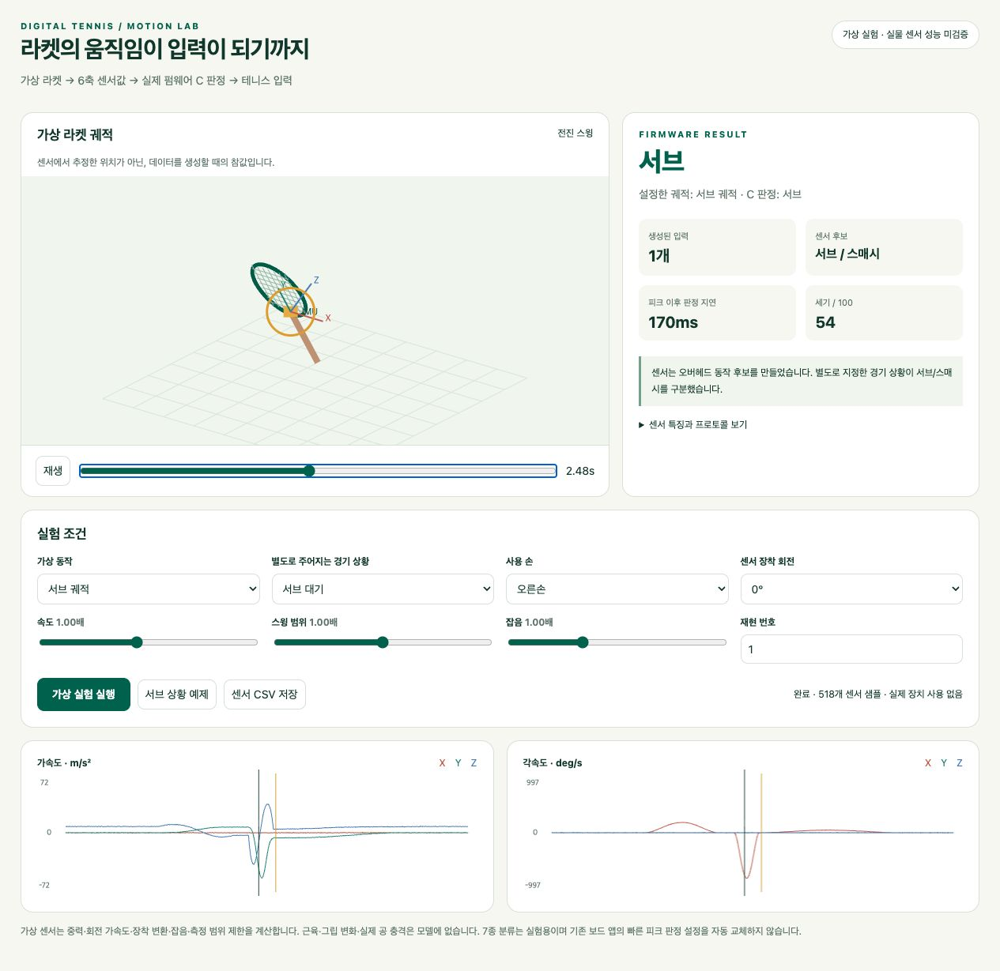

# 테니스 모션 추론과 가상 IMU 실험실

DT-HW-31-22-00 / R01 / 2026-10-20. **NU40-DK + 별도 부착 외장 6축 IMU**가 제품 타깃입니다. NU54는 센서 없는 BLE/버튼 시험용이며 추가 버튼 시험·flash·실물 IMU 검증을 하지 않았습니다. 최초 12일·3명·36PD 계획은 유지합니다. 번호와 절 구성은 ATA iSpec 2200을 참고한 자체 관리 방식이며 공식 적합성을 주장하지 않습니다.

## 구현된 것과 기본 앱의 경계

드럼 스틱의 가속도 피크를 액션으로 바꾸듯이, 라켓의 회전 방향·범위·시간·가속도에서 테니스 입력 의도를 추론하는 **실험용 7종 C 프로필**을 구현했습니다. 가상 라켓에서 6축 값을 생성하고 실제 펌웨어 C 코드에 재생하여 그 가설을 검토합니다. 기대 동작 이름은 평가용이며 C로 전달하지 않습니다.

**기본 보드 앱은 기존 빠른 피크 프로필을 유지합니다.** 새 프로필은 스윙 해제를 기다려 지연이 있고, 서브/랠리 상태를 보드에 보내는 BLE 명령도 아직 없습니다. 이 결과를 Unity 실물 7종 자동 인식 완료로 해석하지 않습니다.



## 어떤 모션을 어떻게 구분하는가

중립 자세 기준 X=오른쪽, Y=네트 방향·라켓 손잡이→헤드, Z=위인 오른손 좌표계를 가정합니다. 각속도는 라켓에 붙은 축으로 관찰하며 장착 회전·좌우손을 명시합니다.

| 입력 | 관찰할 특징 | 센서만으로 알 수 없는 것 |
| --- | --- | --- |
| 포핸드 / 백핸드 | 서로 반대인 큰 횡회전 | 모든 사람·그립에서 부호만으로 일반화되는지 |
| 서브 / 스매시 | 위에서 내려치는 overhead 후보 | **같은 6축 파형일 수 있어 서브 대기/랠리 상태 필요** |
| 발리 의도 | 작은 범위의 짧은 전방 펀치 | 실제 바운드 전 타격인지는 게임이 판단 |
| 슬라이스 의도 | 횡회전과 아래로 자르는 성분 | 공에 실제 백스핀이 생겼는지 |
| 로브 의도 | 횡회전과 위로 들어올리는 성분 | 공이 상대의 머리 위를 넘어가는지 |

표준 테니스의 의미와 게임 컨트롤러 의도를 구분합니다. 스킬kind8은 기존 명시 버튼/모드를 유지합니다. 타격 가능 거리·높이·타이밍·스킬 재고는 게임이 판단합니다.

## 장비 없이 실행하기

[펌웨어 고정 소스](https://github.com/digital-tennis/digital-tennis-firmware/tree/b0db0789b28e6b101fb35dae09541d5700f9da10)의 저장소 루트에서 CMake 3.20 이상·C99 컴파일러·Python 3로 실행합니다. Python 외부 패키지는 필요하지 않습니다. protocol은 기존 고정 SHA로 취득합니다.

```sh
cmake -S . -B .work/motion-simulator
cmake --build .work/motion-simulator
ctest --test-dir .work/motion-simulator --output-on-failure
python3 simulator/server.py --port 8766
```

<http://127.0.0.1:8766/>에서 동작·상황·좌우손·장착·속도·범위·잡음·재현 번호를 바꿔 실행합니다. 라켓 재생과 타임라인, 6축 그래프, 후보/판정/세기/지연/패킷을 비교하고 센서 CSV를 저장할 수 있습니다. 서버는 로컬 인터페이스에만 바인딩합니다. BLE·Unity·실제 장치를 조작하지 않으며 중지는 Ctrl+C입니다. 화면의 위치는 센서로 복원한 값이 아닌 생성기의 참값입니다.

```sh
python3 simulator/run.py --motion slice --context rally --left --mount 90 --out .work/slice.json
python3 simulator/evaluate.py --repetitions 100 --validation-seed 731091 --out .work/motion-validation.json
.work/motion-simulator/imu_replay --gestures --diagnostics --context=rally samples.csv > decisions.csv
```

실제 녹화도 `time_ms,ax_mps2,ay_mps2,az_mps2,gx_dps,gy_dps,gz_dps` 7열로 같은 C 실행기에 넣을 수 있습니다. 첫65개 이상 정지 표본, 실제 장착 행렬과 좌우손을 사용합니다. label은 별도 메타데이터로 보관합니다. 시각 누락을 임의 보간하지 않습니다. [UART 기록·변환 안내](imu-air-band.md)를 따릅니다.

## 가상 데이터가 만들어지는 방식

`simulator/motions.csv`는 준비·전진·복귀 각도와 시간·전방 이동량을 정의합니다. `physics.py`는 이를 부드러운 3D 궤적으로 바꾸고, 회전 중심에서 떨어진 센서 위치의 2차 미분에서 중력을 빼 센서축으로 변환합니다. 자이로는 회전 행렬의 변화량에서 deg/s로 구합니다. 접선·구심 가속도, 장착 회전, 왼손 반사, 고정 bias·잡음·16비트 양자화·±16g/±2000deg/s 포화를 포함합니다. 공을 맞았다고 가정한 인위적 충격 피크는 넣지 않습니다.

이 물리 생성기는 판정 규칙 CSV를 읽지 않습니다. 정지 중력·일정 병진 가속도·등속 회전의 알려진 물리값과 비교하는 검사가 있습니다. 그러나 사람의 관절·그립 변화·공 충격·실측 센서 손실·무선/Unity 지연은 모델에 없습니다. 이 모델을 실제 사람의 학습/검증 자료 대신 사용하지 않습니다.

## 평가 결과와 반례

준비 시드1701과 분리한 평가 시드731091을 사용했습니다. 평가 전 동작/규칙 CSV를 고정했고 누락에 맞춰 규칙을 다시 조정하지 않았습니다. 속도±25%, 범위±15%, 잡음0.3..1.3배, 센서 offset0.20..0.30m, 좌우손·장착0/90/180/270도를 섞은 결과입니다.

| 기대 입력 | 맞게 판정 / 표본 | 미인식 |
| --- | --- | --- |
| 포핸드 | 99 / 100 | 1 |
| 백핸드 | 100 / 100 | 0 |
| 서브 | 100 / 100 | 0 |
| 스매시 | 100 / 100 | 0 |
| 발리 | 86 / 100 | 14 |
| 슬라이스 | 100 / 100 | 0 |
| 로브 | 100 / 100 | 0 |

685/700(97.9%)은 **정의한 가상 분포 안의 일치율**입니다. 다른 알려진 종류로의 오분류는0개, 정의한 일상 동작5종500개에서는 오검출0개였습니다. 중복·잘못된 시점의 입력도0개입니다. 약한 발리는 자이로 시작 임계값을 못 넘는 사례가 있었고 포핸드 누락의 피크는 규칙 하한보다 작았습니다. 실패15개와 전체 혼동 행렬은 [검증 기록](../testing/gesture-simulator-validation.json)에 남겼습니다.

별도 반례는 다음 두 가지입니다. 같은 overhead 파형은 상황 모름일 때 거부하고 서브 상황에서는kind3, 랠리에서는kind4가 됩니다. 동일한 포핸드 움직임의 기대 메타데이터를 ‘의도하지 않은 동작’으로 바꿔도 C는kind1을 출력합니다. 의도를 센서만으로 구분할 수 없으며 이 반례는 위 일상 동작500개에 포함하지 않았습니다.

호스트/ASan·UBSan 각각6개 검사군, 물리·C 연동9개 검사와 NU40 sensorless/MPU6050/LSM6DSO, NU54 buttons 컴파일을 통과했습니다. 실제 C 생성7종 패킷을 기존 C# 코덱·보정된 SDK가 처리하는 메모리 fixture도 확인했습니다. 이번에 Unity에서 실물 IMU 플레이를 검증한 것은 아닙니다.

## 후속 담당자가 고칠 위치

| 요구 | 수정 위치 | 책임 |
| --- | --- | --- |
| 실제 센서 모델·핀·ODR·단위 | firmware `external_imu.c`, 검토한 overlay | [실물 인수 표](imu-handoff.md)부터 작성 |
| 가상 궤적·센서 모델 | `simulator/motions.csv`, `physics.py` | 판정 규칙과 독립적으로 물리값 검증 |
| 특징·후보·상황 판정 | `src/ap/dt_gesture.c` | 마지막 연속 회전의 방향·범위·시간·일관성·피크 |
| 판정 범위 | `config/gesture-rules.csv` | CMake로 헤더 생성·**재빌드 필요**. 런타임 CSV 수신 기능 없음 |
| 실험 프로필 선택 | `dt_motion_gesture_defaults`, `main.c` | 기본 앱은 기존 peak 유지. 변경 전 지연/CPU/RAM 측정 |
| 서브/랠리 상태 | `dt_controller_set_context` | **C setter만 있음**. protocol→firmware→SDK→game의 버전/ACK/만료/끊김 초기화 구현 필요 |
| 게임의 적중·효과 | 기존 SDK→`NativeControllerBackend`→`SubmitInput` | 본딩/보정/중복 gate와 테니스 규칙 유지 |

실험 프로필은128개 raw 샘플 ring을 직접 읽으며 기본 프로필의 논리 보관은20개입니다. 자료형 버퍼는 두 경우 모두128개 정적 할당입니다. 해제까지 기다리는 가상 판정의 피크 후 지연은 중앙값170ms·최대360ms로, CPU 실행 시간이나 전체 BLE 지연이 아닙니다. 상황 setter는 매치 상태 전환 때만 호출하며 호출 시 진행 중 스윙을 취소합니다. 보드 기본값 전환은 실물 정확도·전체 지연·실제 경기 체감과 상태 연동을 검증한 뒤 결정해야 합니다.

[펌웨어 상세 설계·함수별 과제](https://github.com/digital-tennis/digital-tennis-firmware/blob/b0db0789b28e6b101fb35dae09541d5700f9da10/docs/tennis-gesture-simulator.md)에는 좌표·식·이유 코드·C 통합 예제를 제공합니다. 기존 protocol v2 20바이트 계약·SDK/game 패키지 참조는 변경하지 않았습니다.

## 참고 근거

[Air Band 분석](imu-air-band.md)의 고정 소스·스틱 영상·제작자 설명에서 움직임→센서→액션 구조를 참고했습니다. 라이선스 없는 코드/자산은 복사하지 않았습니다. [ITF 용어](https://www.itftennis.com/en/about-us/organisation/tennis-glossary/)로 실제 샷의 의미를 확인하고, [Ebner·Findling 연구](https://ambientintelligence.aalto.fi/paper/Tennis_Stroke_Recognition.pdf)의 사람·센서 위치별 수집/특징 평가 접근을 참고했습니다. 해당 논문의 모델이나 성능을 본 프로젝트 결과로 사용하지 않습니다. 자체 코드·문서는 Apache-2.0이며 외부 조건은 유지합니다.
