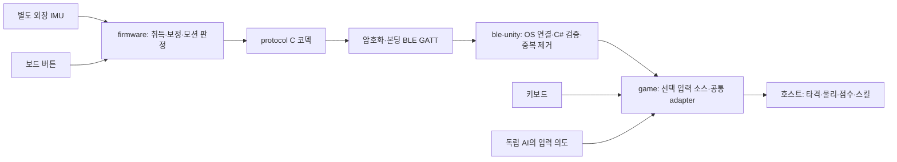

# DT-SDD-00-10-00 · 시스템 구조와 책임

## 00 문서 관리

| 항목 | 내용 |
| --- | --- |
| 문서 ID / 개정 | DT-SDD-00-10-00 / R02 |
| 발행 / 상태 | 2026-10-18 / 구현 브랜치 검토본 |
| 적용성 | NU40-DK + 별도 외장 IMU, Mac/Windows Unity PC. NU-54는 임시 BLE 시험 타깃 |
| 책임 / 검토 | docs / firmware·protocol·SDK·game 담당자 공동 검토 |
| 일정 기준 | 최초12일·3명·36인일, 원래37과제/72반일 슬롯 보존 |
| 개정 범위 | 판정 위치 ADR-001, 연결/센서 상태 분리, 저장소 책임·검증 추적 |

ATA iSpec2200에서 영감을 받은 문서 ID·개정·적용성·유효 절·절차/검증 추적 형식을 사용한다. DT 번호는 프로젝트 자체 번호이며 항공기 ATA 챕터 번호가 아니다. iSpec2200 원문/SGML DTD·공식 적합성 인증은 포함하지 않는다. [ATA 공식 범위](https://ataebiz.org/standards/).

| 유효 절 | 내용 | 개정 |
| --- | --- | --- |
| 10 | 제품 책임·데이터 흐름 | R02 |
| 20 | ADR-001 판정 위치 | R02 |
| 30 | 연결·입력·저장 절차 | R02 |
| 40 | 온라인 권위 | R01 유지 |
| 50 | 통합/검증 추적 | R02 |

## 10 제품 책임과 데이터 흐름

| 저장소 | 소유하는 책임 | 경계를 넘기지 않는 책임 |
| --- | --- | --- |
| firmware | GPIO/IMU 드라이버, SI 샘플, 장착 축, 보정, 스윙 구간/액션, 송신 큐, GATT/보안·bond 저장 | 공의 위치·Near/Far·샷 성공·점수 |
| protocol | UUID, wire 필드/단위/버전/CRC, 보안 상태 schema, C/C# 코덱/벡터 | OS 호출·모션 분류·게임 규칙 |
| ble-unity | OS Bluetooth 검색·페어링/암호화/본딩 확인, 연결 세대, 명령 ACK·nonce, 중복/수명·범위 검증 | 샘플의 재분류·테니스 물리 |
| game | 기기별 설정·저장, 입력 소스, 코트 좌표, 타격 유효성, 경기/점수, 화면·사운드·호스트 권위 | 센서 드라이버·OS 키 관리 |
| ai | 순수 상태에서 난이도별 제한된 입력 의도 | Unity 의존·공 순간이동·득점 변경 |
| match-server | 방·역할·재접속 토큰, 시그널링·릴레이 검증 | BLE 처리·공 물리·점수 확정 |
| docs | 계약/책임·과제/WBS·증거·릴리스 기준의 추적 | 중복 코덱·실물 성공의 추정 |

실제 샘플은 `deviceTimeMs + accelMps2[3] + gyroDps[3] + sensorReady`다. SI 가속도(m/s²), 자이로 deg/s를 사용한다. wire는 `eventId + kind + power + yawCdeg + pitchCdeg + flags`인20바이트 이벤트다. SDK 입력에는 PC 단조 수신 시각·연결 세대가 포함되고, game이 자신의 코트 방향으로 매핑한다. MCU와 PC 시계를 직접 빼서 무선 지연으로 사용하지 않는다.

## 20 ADR-001 · 모션 판정 위치

**결정: 기본 제품은 펌웨어에서 액션을 판정한다.** 펌웨어가100Hz 샘플 취득·장착 좌표 변환·영점·필터·스윙 시작/최대/종료·모드/규칙 분류를 수행하고, SDK는 판정된 의도를 검증해 전달한다. 게임은 그 의도가 지금 유효한 타격인지 별도로 판정한다. 측정된 물리 동작과 게임 결과는 서로 다른 판정이다.

| 선택지 | 이점 | 비용/제약 | 채택 |
| --- | --- | --- | --- |
| 원시 샘플을 PC에서 분류 | 알고리즘 실험·녹화·수정이 쉬움 | 샘플 순번/시간/누락·전송량·OS 일정에 대한 별도 계약 필요 | 향후 연구 프로필 |
| 펌웨어 분류 후 이벤트 | 고정 취득 시계, 보정 단일 소유, 작은 전송량, OS 독립 | 펌웨어 배포가 필요하고 실제 센서 데이터로 튜닝해야 함 | 현재 기본 |
| PC/펌웨어가 둘 다 분류 | 부분 실험 가능 | 이중 판정·중복·상충 상태 | 채택 안 함 |

BLE는 원시 데이터를 연속 전송할 수 있다.20바이트는 ATT_MTU23 호환을 위한 현재 이벤트 크기이지 BLE 전체의 절대 최대치가 아니다. 예시로20B×100Hz=2,000B/s, 이벤트2회/s×3회×20B+STATUS20B=140B/s다. 무선 헤더·재전송·보안 비용을 제외한 비교이며 처리량/지연 보장이 아니다. [Bluetooth SIG ATT](https://www.bluetooth.com/wp-content/uploads/Files/Specification/HTML/Core-54/out/en/host/attribute-protocol--att-.html).

마우스 비유에서는 물리 버튼·센서 보고와 OS의 클릭/더블클릭 해석을 구분해야 한다. 본 제품도 firmware의 스윙 의도와 game의 타격/스킬 문맥을 구분한다. HID 마우스 프로필을 구현하지 않고 사용자 정의 GATT를 사용한다. 원시 연구 스트림이 필요하면 protocol에 새 프로필·단위·주기·시계/누락·버전 정책을 먼저 정의한다.20바이트 기존 필드에 원시값을 임의 삽입하지 않는다.

## 30 연결·보정·사용 설정

`검색 → 본인 기기 선택 → OS 페어링/보호된 GATT → 현재 peer 암호화+bond 확인 → 통신 왕복 → 외장 IMU 보정 → 서브/스윙/스킬 확인 → 저장`.

- 단순 GATT 연결은 본딩이 아니다.4바이트 보안 특성으로 현재 보안 등급과 peer bond를 확인한다. Mac 공개 API에 없는 OS 키 DB를 직접 읽었다고 주장하지 않는다.
- `LINK_PROBE/REPLY`는 현재 연결·nonce·2초 제한을 검증한다. Write 성공과 응답 수신은 다르다.
- 센서 없는 본딩/통신 성공은 ready/calibrated를 바꾸지 않는다. 동작 테스트/저장은 잠겨 있어야 한다.
- 상세 메뉴의 취소는 저장된 소스를 유지한다. 저장만 영속 설정과 게임 입력 소스를 변경한다. 끊김 때 키보드로 몰래 대체하지 않는다.
- 재접속은 새 연결 세대·보안 확인·보정/동작 테스트를 요구한다. 이전 스윙/ACK/nonce를 재생하지 않는다.

보드·PC는 bond를 각각 저장한다. 연결 해제는 bond 삭제와 다르다. 인증 방법·최초 본딩·키 재사용·보드 재시작 결과는 [실물 본딩 기록](controller-bonding.md)에 구분한다. IMU 미장착 상태를 성공으로 위조하지 않는다.

## 40 온라인 권위

호스트 PC만 공·충돌·득점·승패를 확정한다. 게스트는 입력을 보내고 호스트 상태를 보간한다. 두 Unity 물리가 우연히 같은 결과를 내는 구조가 아니다. AI도 같은 입력 검증 경계를 통과한다.

Unity가 WebRTC DataChannel을 협상하고 실패하면 양쪽이 새 epoch의 WebSocket 릴레이에 합의한다. 서버는 방 코드·시그널링·역할·릴레이 검증을 소유한다. WebSocket 연결만으로 직접 P2P라고 부르지 않는다. 같은 Mac 두 프로세스와 서로 다른 두 PC/WAN 실기는 별도다. [온라인 계약](../contracts/online-protocol.md).

## 50 검증과 변경 순서

| 요구 | 증거/도구 | 한계 |
| --- | --- | --- |
| DT-REQ-001..004 책임 분리 | 이 표·각 README·프로토콜 ICD | 실물 인식률 아님 |
| 양언어 wire | protocol2,045사례 및 보안66,046사례 | OS 본딩 아님 |
| 누락된 보안/다른 peer 차단 | SDK44개 검사 | 모의 라디오 |
| 센서 없음·송신/버튼·모션 | firmware host2모음·NU40/NU54 컴파일 | 실물 IMU 미검증 |
| 실제 Unity 설정 | 본딩 기록·게임 프레임 캡처 | 사용한 보드/OS 범위만 |
| 테니스 규칙/메뉴 회귀 | Unity Edit/Play/GPU 검사 | Windows 실기 별도 |
| 방·권한·실소켓 | 서버28개 검사 | WAN 운영 별도 |

변경은 protocol→firmware/SDK→game→docs 순서로 검토한다. 스쿼시 병합 후 소비 SHA를 새 커밋으로 다시 고정하고 main에서 재검증한다. [현재 구현](implementation-status.md), [컨트롤러 후속 작업](controller-readiness.md), [원래 WBS](../planning/wbs.md)를 함께 읽는다.
