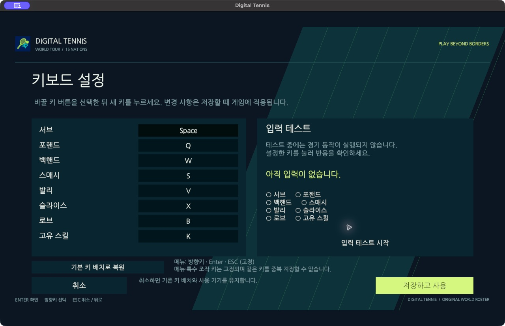
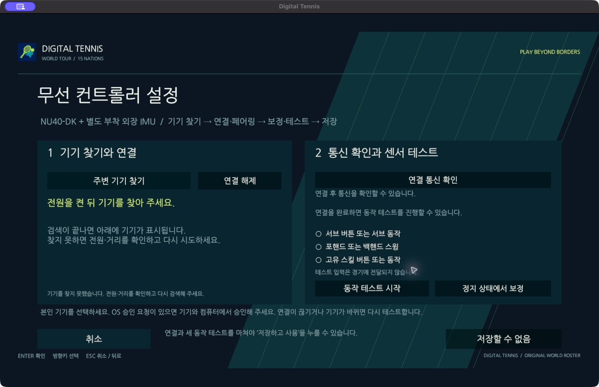

# 컨트롤러 후속 검수와 최신 배포판

2026-10-18. 기존 game main PR24(bf266aa) 이후 **검토 브랜치** 결과다. NU40-DK + **별도 외장 IMU**, 최초12일·3인·36인일 계획을 유지한다. 아래 PR은 main에 병합하지 않았다.

## 순서와 구현

| 순서 | 제품·PR | 변경 | 검증 |
| --- | --- | --- | --- |
| 1 | [protocol PR2](https://github.com/digital-tennis/digital-tennis-protocol/pull/2) | v2 LINK_PROBE/REPLY | C/C# 2,045사례·sanitizer |
| 2 | [firmware PR2](https://github.com/digital-tennis/digital-tennis-firmware/pull/2) | 재전송 큐·버튼·구간 모션·선택 모드/녹화 규칙 | host2모음·보드3구성 컴파일 |
| 3 | [BLE SDK PR2](https://github.com/digital-tennis/digital-tennis-ble-unity/pull/2) | 연결별 nonce/2초 응답·직렬 쓰기·진단 CLI | 39검사·Mac universal/Windows 빌드 |
| 4 | [game PR25](https://github.com/digital-tennis/digital-tennis-game/pull/25) | 통신 진단 UI·패키지 고정·README 기존 게임 캡처3개 | Unity/GPU·일반 Mac 창 |
| 5 | [server PR6](https://github.com/digital-tennis/digital-tennis-match-server/pull/6) | 오래된 relay-only 설명·테스트 수 정정 | 문서 변경·서버 CI28검사 |
| 6 | docs의 이 PR | 현황·과제·계약·배포 근거 연결 | GitBook/링크/WBS/벡터 검사 |

protocol → firmware/SDK → game → docs 순서로 검토한다. **스쿼시 병합 후 소비 저장소의 패키지/CI/CMake 참조도 새 병합 커밋으로 갱신**한다. 이번 배포는 main 배포가 아닌 검토 브랜치의 clean 커밋이다. 병합·운영 서버 배포·GitBook 계정 게시를 수행하지 않았다.

## 처음 따라갈 입력·출력

1. 게임 설정 → 입력 컨트롤러에서 키보드 또는 무선을 연다. 키보드에는 키 배치/입력 테스트만 있다. 상세에서 취소하면 저장된 사용 기기는 그대로다.
2. 무선에서 기기 찾기 → 본인 기기 연결을 진행한다. 필요한 OS 승인은 기기/컴퓨터에서 처리한다. 검색 결과만으로 연결 완료를 표시하지 않는다.
3. **연결 통신 확인**은 센서 없이 LINK_PROBE를 보내 같은 nonce의 LINK_REPLY를2초 안에 기다린다. 쓰기 성공만으로 왕복 성공을 표시하지 않는다.
4. 센서가 없으면 준비/보정은 false이며 동작 테스트·설정 저장은 계속 금지된다. 통신 성공은 보정 성공이 아니다.
5. 외장 IMU 장착 후 정지 보정 → 서브/스윙/스킬 테스트 → 저장을 진행한다. 저장만 게임의 입력 소스를 바꾼다. 연결/기기가 바뀌면 테스트를 재사용하지 않는다.
6. 게임 입력은 선택 소스의 일반 adapter를 통과한다. 센서 단절 때 키보드로 몰래 대체하지 않는다. 재설정을 위한 메뉴 키는 접근 가능하다.

정상 예: 센서 없음 → BLE 연결 → 통신 응답 성공 → 보정 SENSOR_NOT_READY → 저장 불가. 오류 예: 이전 연결/다른 nonce/2초 이후 응답/CRC 오류 → 통신 확인 실패. 가짜 보정·스윙을 만들지 않는다.

## 펌웨어 FW-04·05·06의 현재 범위

32개 유한 송신 큐는 넘치면 가장 오래된 입력을 버리고 drop/expiry를 기록한다. 입력200ms·제어1000ms 만료,20ms 재시도, Swing/Button/제어3회·Status1회를 적용한다. 반복 시 원래 eventId/기기 시각은 보존하고 sequence는 증가한다. 독립 TX worker로 Notify 역압이100Hz 센서 획득을 막지 않는다. 단절/구독 epoch 변경 때 이전 입력을 재생하지 않는다. RX callback은8개 명령 큐에 검증된 명령만 넣고 메인 루프가 보정 작업을 처리한다. 연결별 구독·암호화·수명과 bonding 설정 보존을 적용했다.

버튼은30ms 안정화 후1회, 누름 유지 중 반복0회, 부팅 시 눌림은 놓은 뒤부터 받는다. 선택 alias racket-confirm/start/pause/skill/shot이 없으면 임의 핀을 추정하지 않는다. skill은 센서 준비/보정 상태에서만 생성하고 shot은 auto→smash→volley→slice→lob→auto로 선택한다. 실제 GPIO/극성은 장비 검증 대상이다.

모션은 onset→peak→release, 최소20ms/최대1000ms·샘플 간격100ms 상한과 주입 설정을 사용한다. 구간 내 상대 회전과 peak로 방향/세기를 계산하며 절대 위치 추적을 주장하지 않는다. 기본 자동 포핸드/백핸드/서브, 명시적 특수 샷 선택, 최대8개 녹화 분류 규칙을 구분한다. 합성8프로필·왼손·누락/짧음/지속 동작 테스트는 **사람8제스처 인식률**이 아니다. firmware docs/controller-refinement-validation.json에 소스·ELF/HEX 해시를 보존했다. 생성 Kconfig cache 문제는 generated 디렉터리 pristine 재생성으로 해결했고 경고를 숨기지 않았다.

## 참고 코드와 실제 NU-54

사용자가 제공한 nu-54v-dk-toy/products의 ee12b7519336ed276060b83c69f4f863f557443a에서 ble_links.c/central.go의 연결 수명·구독/Notify 역압·bonding·직렬 WriteWithResponse 패턴을 검토했다. 결제·지갑·프로비저닝 기능을 가져오지 않았다. NU-54 참고 서비스/CBOR 또는 NUS와 테니스 서비스/20바이트는 다른 계약이다.

초기에는 USB의 NU54DK_v2_Pre-release와 켜진 Mac Bluetooth만 확인됐고, 원본 검색의 주변10기기 중 참고 서비스는 없었다. 후속 동시 관찰에서는 SW3 직후 NU54-HW- 광고와 서비스6e753534-7061-7900-8000-00805f9b0001, RSSI -51dBm를 확인했다. 사용자가 본 전체 LED 두 번 점멸은 참고 코드 P_PAIRING과 일치한다. 앞선 미검출의 원인을 확정하지는 않는다. USB 콘솔은0바이트였으며 이 앱은 CLI 예제가 아니므로 ble info 무응답만으로 펌웨어 이상을 판단하지 않는다.

### 2026-10-18 추가 실물 통신 성공

광고를 발견하는 즉시 같은 프로그램에서 NU54-HW-Wallet에 연결해 서비스/특성을 찾고 TX Notify 구독 후 RX WriteWithResponse를 수행했다. 읽기 전용 device.info를 canonical CBOR·0의8바이트 sessionId·길이/SHA256 envelope로2회 전송했고 각각211.32ms/209.66ms에 완전한 응답을 받았다. 응답 길이·digest·CBOR 버전/session/type을 확인한 뒤 구독 종료·연결 해제까지 성공했다. 시간에는 명령 조각 쓰기와 앱 응답이 포함되며 센서 지연이 아니다.

두 응답은 error/NOT_PERMITTED였다. 참고 firmware의 ss_device_info는 현재 연결에 bonded 권한이 없으면 이렇게 응답하며 저장 상태를 바꾸지 않는다. 이는 **실물 BLE 연결·양방향 애플리케이션 메시지 전달 성공**의 근거이고, 정보 조회 허용이나 **SMP/OS 본딩 완료**는 아니다. Mac Bluetooth 설정에서도 해당 기기의 본딩 완료는 확인하지 못했다. [실물 통신 결과](../testing/nu54-transport-validation.json)를 확인한다.

기존 보드 펌웨어/설정·bond를 덮어쓰거나 초기화하지 않았다. session.open·결제·프로비저닝·센서 보정 명령도 보내지 않았다. 공개 결과에는 기기 UUID·지갑 주소·PIN/passkey·원시 응답을 남기지 않았다. **이번 시험은 참고 NU-54 서비스/CBOR 계약**이다. 테니스용 UUID/20바이트 송수신 및 Unity의 실제 컨트롤러 입력 성공으로 바꿔 표기하지 않는다. Unity의 테니스 전용 검색0기기 기록도 그대로 보존하며 외장 IMU 검증은 유예한다.

## Unity·일반 창 검증

Unity6000.3.26f1 프로젝트 검사, Edit189/189, Play43통과·0실패·1 Null GPU 제외, 별도 GPU 마우스1/1, 패킷 장면1/1 통과. 일반 창 MOCK 검증은15화면·오류0, Near1/Far2타격·득점1·다음 서브·단절 일시정지를 통과했다. 실제 코덱/SDK/adapter를 사용하지만 **라디오는 MOCK**으로 실물 페어링 증거가 아니다. 화면 전환 직후 다음 UI를 호출하던 검증기 문제는 렌더/전환 대기를 추가해 재검증했다.

최종 비개발 Mac 배포판은 일반 창에서 실제 키보드로 인트로/메뉴→설정→키보드 상세/취소→무선 상세/실제 검색/취소→한국/일본MediumAI/한국코트→Space서브→AI반환/득점0–15→다음Space서브→득점0–30을 확인했다. Q입력도 HUD에 표시됐다. 검증 후 종료해 반복 사운드를 남기지 않았다. 이번 일반 창에서는 물리 마우스 클릭 성공을 새로 주장하지 않는다. CUA 클릭은 UI를 활성화하지 못했으며 이전 main PR24의 실제20회 근거와 이번 Unity GPU raycast 통과를 구분한다.

CI의 protocol/firmware/SDK/server 및 game source 검사가 통과했다. GitHub Unity job은 건너뛰므로 로컬 검수와 구분한다. [기계가 읽는 전체 결과·커밋·배포 명세](../testing/controller-readiness-validation.json)와 game PR의 docs/evidence/controller-readiness-2026-10-18에 근거를 보존한다.

## 최신 배포판

소스 game126942ea17f3ba985e86fdb13d7322f410276682, protocol d9a36826afbafa27a0e276cc53e44c904d05be53, SDK ecbf54c7d15fb7cb519ee0a8d93534a54a7abc90. 두 배포판 모두 clean source·Development=false·AllowDebugging=false다. native helper·라이선스·ZIP CRC/SHA256을 검사했고 Mac deep/strict 서명을 확인했다. Mac은 로컬 ad-hoc 미리보기이고 Windows는 교차 빌드만 했다.

| 파일 | 바이트 | SHA-256 |
| --- | --- | --- |
| DigitalTennis-release-mac-126942ea.zip | 93629622 | 2f9a031abaf2c88ac69ecbe8862a94680a12c6c2a3cc012c5d3be2d485953b5c |
| DigitalTennis-release-windows-126942ea.zip | 195621093 | 0a2c928ad448023d7ed2be1d70cb2eb597ab99ea92556a26c46a8fb35af0a356 |

대용량 ZIP·실행 로그 원본은 Git 밖 작업 전달 폴더에 두고 최종 답변에서 다운로드 링크로 전달한다. 재현은 game의 release-mac/release-windows 후 tools/package-release.py를 사용한다. main 병합 후에는 clean 빌드와 sourceCommit·체크섬을 다시 생성한다.

## 남은 장비·외부 결정

실물 IMU 모델/배선/축·버튼 핀/극성·스윙 정확도·전파 지연/재연결/연속 사용, SMP/OS 본딩과 실제 테니스 펌웨어 서비스/입력, 물리 Windows 실행/BLE·서로 다른 두 PC/WAN은 남아 있다. NU-54 참고 서비스의 광고/연결/기본 RX·TX는 위 추가 실기로 확인했다. GitBook 계정 게시·외부 서버/TURN 운영·BGM A/B·음성/자산 채택·밸런스 최종 승인은 팀 결정이며 소프트웨어 검수로 완료 처리하지 않는다.
